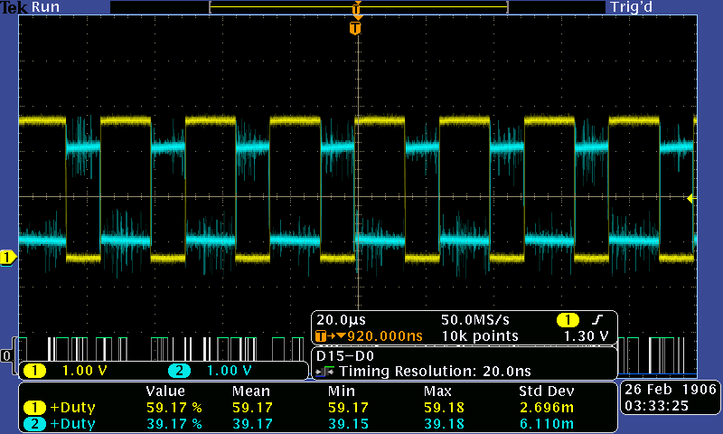

# 2526_ESE_AAA_<TAILLEPIERRE>_<TAOUIS>

**Séance 1 : commande MCC basique (parties 6.1 et 6.2)**

Le code est organisé par fonction, comme demandé : app.c initialise les modules, motor.c gère la PWM et les commandes du moteur, le shell sert d'interface avec l'utilisateur. Aucune fonction du code applicatif ne cite directement l'UART2 : seules shell_uart2_transmit et shell_uart2_receive dans app.c font le lien avec le matériel.

**6.1 Génération des 4 PWM**

**Pins utilisées**

Les deux bras U et V du hacheur sont pilotés par TIM1 :

| Signal | Pin | Fonction TIM1 | Rôle                    |
|--------|-----|---------------|-------------------------|
| U_PWM_H| PA8 |      CH1      | bras U, transistor haut |
| U_PWM_L| PB13|      CH1N     | bras U, transistor bas  |
| V_PWM_H| PA9 |      CH2      | bras V, transistor haut |
| V_PWM_L| PB14|      CH2N     | bras V, transistor bas  |

**Commande complémentaire décalée**

Le bras U reçoit le rapport cyclique α et le bras V reçoit 1 − α. La tension moyenne aux bornes du moteur vaut (2α − 1)·V_bus, donc α = 50 % correspond à une vitesse nulle. Dans le code, motor_set_duty(ccr) écrit ccr dans CCR1 et PWM_MAX − ccr dans CCR2.

Pour obtenir 20 kHz avec ARR = 4249 et PSC = 0, il faut le mode center-aligned, où le compteur monte puis redescend :
f_PWM = f_clk / (2 × (PSC + 1) × (ARR + 1)) = 170 MHz / (2 × 4250) = 20 kHz

**Temps mort:**

Le transistor qui s'éteint doit être bloqué avant que l'autre commence à conduire :
  - valeurs typiques : td(OFF) + tf − td(ON) = 40 + 55 − 9,5 ≈ 85 ns ;
  - valeurs max : tOFF(max) − td(ON) = 145 − 9,5 ≈ 136 ns.

Les valeurs de la datasheet sont mesurées avec R_GS = 9,1 Ω. Le driver de grille et la vraie résistance de grille de la carte allongent les temps, d'où une marge d'environ 1,5 fois le pire cas : 200 ns. Cela représente 0,4 % de la période de 50 µs, donc une perte de tension négligeable.

Conversion en DTG : t_DTS = 1 / 170 MHz ≈ 5,88 ns, donc DTG = 200 / 5,88 ≈ 34

**Mesures à l'oscilloscope (sans moteur, sans alimentation de puissance):**
Rapport cyclique 60 % :
Bras U : les deux transistors d'un même bras ne sont jamais passants en même temps, signaux de 0 à 3,3 V.
Temps mort : les curseurs mesurent Δt = 200,0 ns entre l'extinction d'un signal et l'allumage de l'autre, ce qui correspond à DTG = 34.

**6.2 Commande de vitesse par le shell**

La commande à taper dans le terminal est setccr XXXX

Tests :

|Commande    | Résultat attendu                          |
|------------|-------------------------------------------|
|help	       | setccr apparaît dans la liste             |
|setccr 2125 | CCR = 2125, soit 50 % (vitesse nulle)     |
|setccr 3000 | CCR = 3000, soit 70,6 %                   |
|setccr 9999 | saturé à 4037                             |

**Séance 2 :**

**6.3 Commande de vitesse par le shell**
**Branchement :**

Le moteur est branché entre les sorties des bras U et V du hacheur, avec une alimentation de puissance réglée à 40 V et limitée à 5 A.

**Essais :**
|Essai    | Observation                        |
|---------|------------------------------------|
|α = 50 %	| moteur à l'arrêt, courant ≈ 0      |
|α = 70 % | moteur en marche, appel de courant |

    

**Problème observé :**
On observe la présence de pics de courant. À l'arrêt, la force électromotrice du moteur est nulle, donc le courant n'est limité que par la résistance de l'induit. Un échelon de tension appliqué d'un coup provoque un fort appel de courant, qui peut dépasser le courant nominal du moteur.

**7.1 Commande de la vitesse en boucle ouverte**

Deux commandes shell sont ajoutées (même mécanisme que setccr, avec shell_add dans init_device()) :

|Commande | Action                                                                                     |
|---------|--------------------------------------------------------------------------------------------|
|start	  | fixe le rapport cyclique à 50 % (vitesse nulle, CCR1 = PWM_MAX / 2) puis démarre les 4 PWM |
|stop     | 	désactive la génération des PWM (motor_pwm_stop())                                       |

**Tests :**
