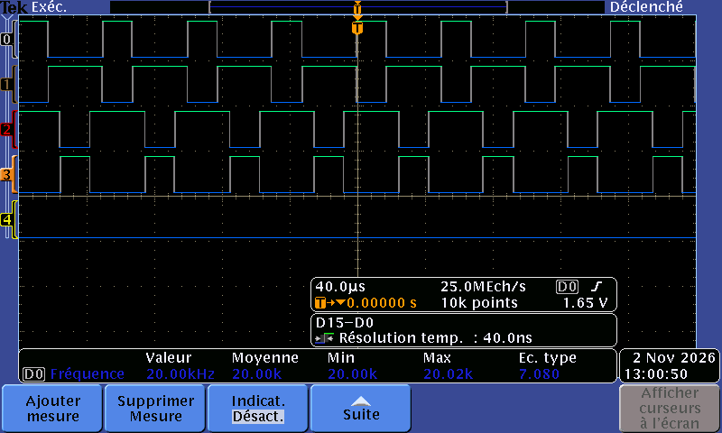
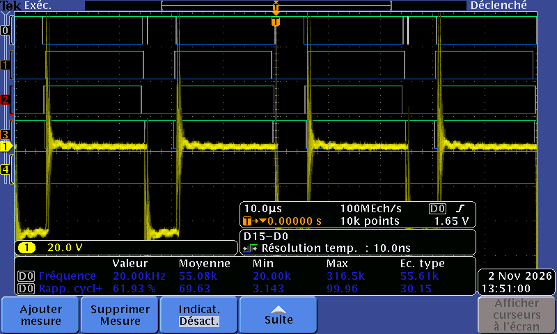
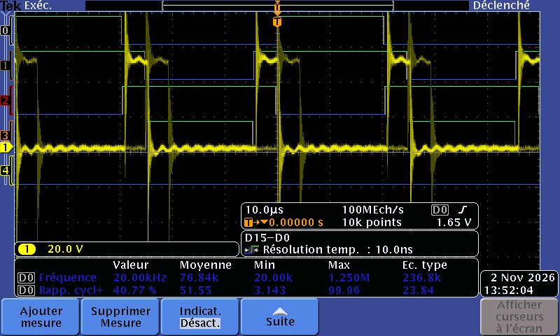
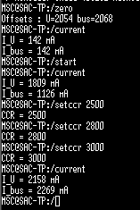
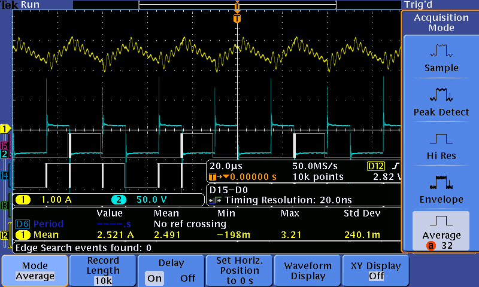
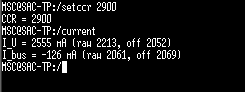
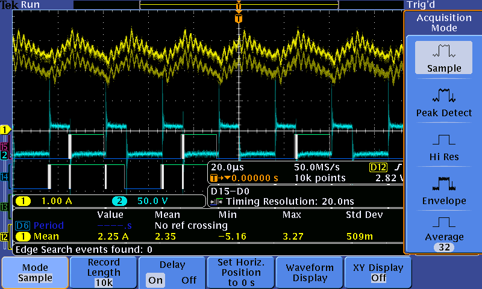

# 2526_ESE_AAA_<TAILLEPIERRE>_<TAOUIS>

**Séance 1 : commande MCC basique (parties 6.1 et 6.2)**

Le code est organisé par fonction, comme demandé : app.c initialise les modules, motor.c gère la PWM et les commandes du moteur, le shell sert d'interface avec l'utilisateur. Aucune fonction du code applicatif ne cite directement l'UART2 : seules shell_uart2_transmit et shell_uart2_receive dans app.c font le lien avec le matériel.

**6.1 Génération des 4 PWM**

**Pins utilisées**

Les deux bras U et V du hacheur sont pilotés par TIM1 :

| Signal | Pin | Fonction TIM1 | Rôle                    |
|--------|-----|---------------|-------------------------|
| U_PWM_H| PA8 |      CH1      | bras U, transistor haut |
| U_PWM_L| PB13|      CH1N     | bras U, transistor bas  |
| V_PWM_H| PA9 |      CH2      | bras V, transistor haut |
| V_PWM_L| PB14|      CH2N     | bras V, transistor bas  |

**Commande complémentaire décalée**

Le bras U reçoit le rapport cyclique α et le bras V reçoit 1 − α. La tension moyenne aux bornes du moteur vaut (2α − 1)·V_bus, donc α = 50 % correspond à une vitesse nulle. Dans le code, motor_set_duty(ccr) écrit ccr dans CCR1 et PWM_MAX − ccr dans CCR2.

Pour obtenir 20 kHz avec ARR = 4249 et PSC = 0, il faut le mode center-aligned, où le compteur monte puis redescend :
f_PWM = f_clk / (2 × (PSC + 1) × (ARR + 1)) = 170 MHz / (2 × 4250) = 20 kHz

**Temps mort:**

Le transistor qui s'éteint doit être bloqué avant que l'autre commence à conduire :
  - valeurs typiques : td(OFF) + tf − td(ON) = 40 + 55 − 9,5 ≈ 85 ns ;
  - valeurs max : tOFF(max) − td(ON) = 145 − 9,5 ≈ 136 ns.

Les valeurs de la datasheet sont mesurées avec R_GS = 9,1 Ω. Le driver de grille et la vraie résistance de grille de la carte allongent les temps, d'où une marge d'environ 1,5 fois le pire cas : 200 ns. Cela représente 0,4 % de la période de 50 µs, donc une perte de tension négligeable.

Conversion en DTG : t_DTS = 1 / 170 MHz ≈ 5,88 ns, donc DTG = 200 / 5,88 ≈ 34

**Mesures à l'oscilloscope (sans moteur, sans alimentation de puissance):**
Rapport cyclique 60 % :
Bras U : les deux transistors d'un même bras ne sont jamais passants en même temps, signaux de 0 à 3,3 V.
Temps mort : les curseurs mesurent Δt = 200,0 ns entre l'extinction d'un signal et l'allumage de l'autre, ce qui correspond à DTG = 34.

**6.2 Commande de vitesse par le shell**

La commande à taper dans le terminal est setccr XXXX

Tests :

|Commande    | Résultat attendu                          |
|------------|-------------------------------------------|
|help	       | setccr apparaît dans la liste             |
|setccr 2125 | CCR = 2125, soit 50 % (vitesse nulle)     |
|setccr 3000 | CCR = 3000, soit 70,6 %                   |
|setccr 9999 | saturé à 4037                             |

**Test :**

    

**Séance 2 :**

**6.3 Commande de vitesse par le shell**
**Branchement :**

Le moteur est branché entre les sorties des bras U et V du hacheur, avec une alimentation de puissance réglée à 40 V et limitée à 5 A.

**Essais :**
|Essai    | Observation                        |
|---------|------------------------------------|
|α = 50 %	| moteur à l'arrêt, courant ≈ 0      |
|α = 70 % | moteur en marche, appel de courant |

    
  

**Problème observé :**
On observe la présence de pics de courant. À l'arrêt, la force électromotrice du moteur est nulle, donc le courant n'est limité que par la résistance de l'induit. Un échelon de tension appliqué d'un coup provoque un fort appel de courant, qui peut dépasser le courant nominal du moteur.

**7.1 Commande de la vitesse en boucle ouverte**

Deux commandes shell sont ajoutées (même mécanisme que setccr, avec shell_add dans init_device()) :

|Commande | Action                                                                                     |
|---------|--------------------------------------------------------------------------------------------|
|start	  | fixe le rapport cyclique à 50 % (vitesse nulle, CCR1 = PWM_MAX / 2) puis démarre les 4 PWM |
|stop     | 	désactive la génération des PWM (motor_pwm_stop())                                       |

**7.2. Mesure de courant**
Les courants à mesurer sont les suivants :

|Courant    | Utilité                                                              |
|-----------|----------------------------------------------------------------------|
|I_U	      | courant moteur (la MCC est entre U et V, donc I_moteur = I_U = −I_V) |
|I_V        | redondant avec I_U                                                   |
|I_bus      | courant absorbé sur l'alimentation (appel de courant, protection)    |

Mesures retenues : **I_U** et **I_bus**.

**Fonction de transfert**
D'après les documentations, le GO 10-SME/SP3 est alimenté en 3,3 V et mesure ±25 A crête, avec une sensibilité de 50 mV/A. Sa sortie est :
Uout = Uref + 0,05 × Ip
Conversion avec l'ADC (12 bits, Vref = 3,3 V) :
Uadc = N × 3,3 / 4095          (0,806 mV par pas)
I    = (Uadc − Uref) / 0,05    (≈ 16,1 mA par pas)

**Pins du STM32 :**

|Signal   | Connecteur | Pin | Channel ADC |
|---------|------------|-----|-------------|
|U_Imes	  | CN7 pin 30 | PA1 |	ADC1_IN2   |
|V_Imes   | CN10 pin 24| PB1 |  ADC1_IN12  |
|W_Imes   | CN7 pin 34 | PB0 |  ADC1_IN15  |
|Bus_Imes | CN7 pin 35 | PC2 |  ADC1_IN8   |

**Mesure en polling :**
Le code est dans acquisition/input_analog.c. Pour chaque lecture, adc_read_raw() configure le canal ADC1 voulu (PA1 pour U_Imes, PC2 pour Bus_Imes), lance une conversion logicielle (HAL_ADC_Start), attend la fin (HAL_ADC_PollForConversion) et lit le résultat.
Deux commandes shell servent aux tests : zero (mesure d'offset) et current (affiche I_U et I_bus en mA).

**Résultats en polling :**

    

    

Offsets mesurés après zero : U = 2054, bus = 2068. Ils sont proches du milieu de l'échelle (2048), ce qui est cohérent avec une référence de capteur d'environ 1,65 V.

|Condition                      | I_U   | I_bus  |
|-------------------------------|-------|--------|
|PWM arrêtées, juste après zero	|142 mA |	142 mA |
|après start                    |1809 mA| 1126 mA|
|setccr 3000                    |2158 mA| 2269 mA|

**Analyse**
Courant nul : la lecture d'environ 142 mA correspond à 9 pas ADC (16 mA par pas). C'est le bruit de l'ADC et du capteur.
Dispersion avec la PWM en marche : Le polling convertit à un instant quelconque de la période PWM, donc la valeur lue dépend de cet instant. Cela explique les écarts entre lectures successives, et le fait que I_bus peut dépasser I_U alors que sa valeur moyenne vaut (2α − 1) × I_moteur.

Pour obtenir des mesures reproductibles et fiables, l'instant d'acquisition doit être fixé par rapport à la PWM, c'est l'objectif de la chaîne Timer/ADC/DMA.

**Acquisition Timer / ADC / DMA**

Principe :
TIM1 (center-aligned) → CH4 (comparateur interne) → TRGO (OC4REF) → ADC1 (scan, 2 canaux) → DMA circulaire → buffer[2]

Déclenchement : TIM1 est le timer de la PWM. Son canal 4, sans sortie, passe à un état actif quand le compteur redescend sous CCR4. Ce front est envoyé en TRGO et déclenche l'ADC une seule fois par période PWM (20 kHz).
Instant de mesure : CCR4 = ADC_TRIGGER_CCR (250, soit environ 1,5 µs avant le creux du compteur). La mesure est centrée sur le milieu de l'état haut du bras U, loin des fronts de commutation, donc sans bruit de commutation.
Acquisition : l'ADC1 est en mode scan sur 2 channels (rang 1 : PA1 / U_Imes, rang 2 : PC2 / Bus_Imes). Le DMA, en mode circulaire, copie les résultats dans adc_dma_buffer sans intervention du CPU.
Offset : les 64 premières séquences (ou la commande zero) servent à calculer l'offset de chaque capteur.

    

    

**Comparaison avec le polling :** On obtient des resultats beaucoup plus fiable avec cette chaine d'acquisition

